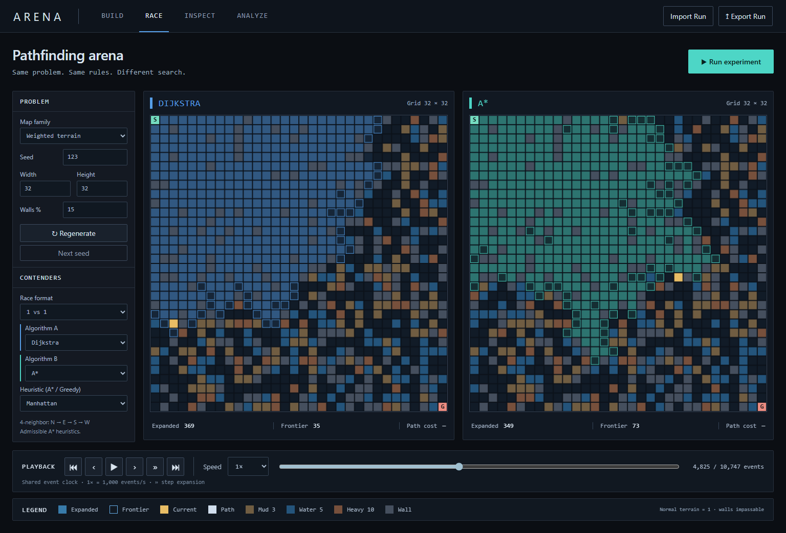
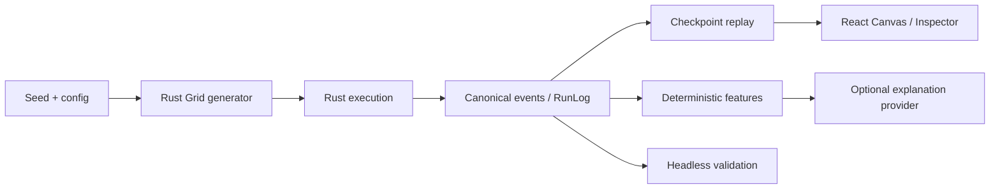
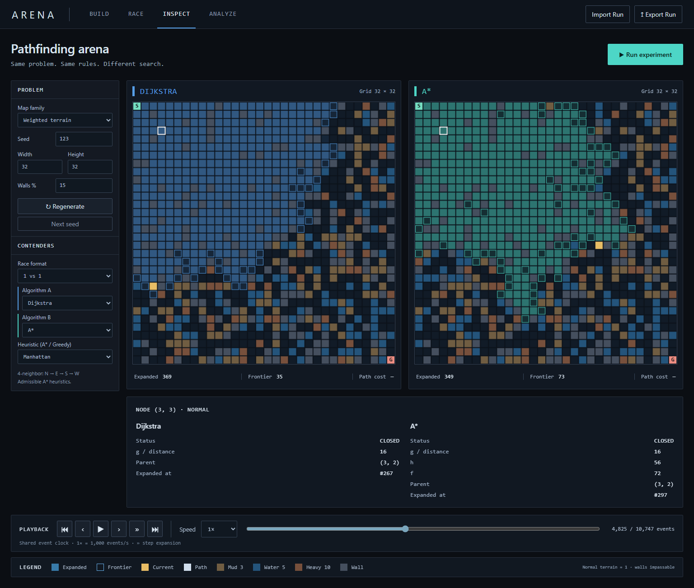
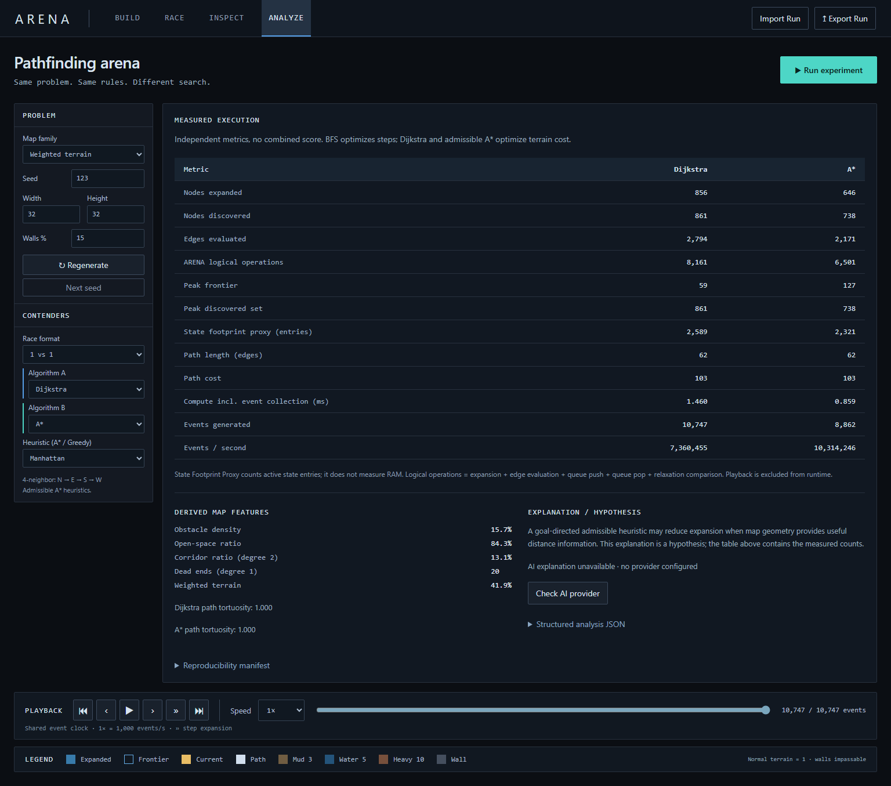

# ARENA — AI Algorithm Arena

An execution-driven 2D pathfinding experiment platform built with Rust, React, TypeScript, Vite and Tauri 2. Compare algorithms on the same problem, inspect recorded state and replay the exact event log offline.



## Product

- **BUILD:** seeded generators, dimensions, start/goal placement, drag painting, weighted terrain, erase and clear. Editing invalidates the previous run.
- **RACE:** configurable 1v1 or four contenders, shared event clock and Canvas rendering. Default Dijkstra vs A*.
- **INSPECT:** real recorded status, distance, h/f where applicable, parent and expansion sequence.
- **ANALYZE:** measured comparisons, deterministic map features and structured explanation input.
- **Replay:** play/pause, event forward/backward, expansion step, seek, beginning/end, 0.25×–8× and MAX; `.arena.json` import/export.
- **Headless:** execution, canonical hashes, saved-log replay, gates and benchmark JSON/readable summaries.
- **Windows:** x64 executable and unsigned NSIS installer; actual packaged execution, replay, inspection and analysis verified with HTTPS requests blocked.

No API key is required. Execution never calls an LLM. The optional explanation provider interface is isolated; the bundled provider reports unavailability. No live AI provider is configured.

## Architecture



`arena-core` owns generation, execution, events, accounting, validation and analysis. `arena-cli` is headless. Tauri commands call the same application service on a blocking worker. The Vite development adapter invokes the Rust CLI; it has no fake-data fallback or TypeScript search implementation. `src/playback.ts` knows only the event contract. Canvas subscribes to batched playback updates, without per-event grid allocations in React.

Execution finishes into a log before visual playback starts. Playback duration never enters runtime metrics.

## Algorithms

| Algorithm | Frontier | Guarantee |
| --- | --- | --- |
| BFS | FIFO | Optimal steps on uniform grids |
| Dijkstra | Priority queue | Optimal non-negative terrain cost |
| A* | Priority queue, g + h | Optimal cost with supported admissible heuristics |
| DFS | LIFO | Reachability; no shortest-path guarantee |
| Greedy | Priority queue, h | Reachability; no shortest-path guarantee |

Four-direction neighbors: N → E → S → W. DFS emits neighbors in that order and explores the last eligible pushed node first. Heap ties prefer lower priority, lower h, earlier insertion. Manhattan, integer-floor Euclidean, Chebyshev and zero are all admissible/consistent with four-direction movement and minimum cost 1.

Destination terrain costs: normal **1**, mud **3**, water **5**, heavy **10**; walls are impassable. Start costs zero. Start may equal goal. Unreachable path cost/length is null, not zero.

Generators: open, obstacles, recursive backtracker, recursive division, rooms, corridors, weighted terrain and a heuristic stress map. Disconnected random maps are not silently repaired. Interactive dimensions: 1–128; headless: 1–256.

## Determinism and replay

SplitMix64 v1 is the sole seeded RNG, using explicit wrapping arithmetic and unbiased bounded sampling. Logs record grid, seed, generator config/version, RNG/version, algorithm/version, heuristic, neighbor/tie-break rules, terrain costs and engine/schema versions. For edited maps, the saved grid is authoritative.

Canonical SHA-256 covers compact ordered serialization of deterministic inputs, metadata, events and algorithmic metrics. Runtime is excluded. Schema 1 uses typed events with event sequence and expansion tick; immutable identity/configuration is log-level. The UI supports safe JavaScript integer seeds; the CLI accepts full u64 seeds.

Rust validates imported versions, hashes, paths, event ordering and accounting; race logs must share the exact problem. Replay reads saved events without search. Checkpoints use at least 256 events, increasing the interval to cap full-state snapshots at 33. Race playback uses one event-count clock: 1× = 1,000 events/s per contender. Step Expansion advances to the next expansion in any contender. See [execution contracts](docs/contracts.md).

## Metrics

Expanded/discovered nodes, evaluated traversable edges, frontier pushes/pops, comparisons, cost updates, peak frontier, final path edges/cost and event counts are measured from execution.

**ARENA Logical Operations** = expansion + edge evaluation + queue push + queue pop + relaxation comparison, each +1. This is not CPU instructions. Stale heap pops count as pops, not expansions.

**State Footprint Proxy** counts peak active discovered/cost/parent/frontier entries, not RAM or bytes. Compute measures search plus event collection/accounting; generation, hashing, serialization and playback are outside that interval. Events/sec uses compute duration.

Analysis separates measured metrics, derived obstacle/open-space/corridor/dead-end/weighted ratios and path tortuosity, and explicitly labeled hypotheses. Expansion ratio to Dijkstra appears in the structured summary; no undefined overall score is used.

## Development and checks

Prerequisites: Node 24+, Rust stable, Visual Studio C++ build tools for Windows/MSVC, and WebView2 Runtime for desktop.

```powershell
npm ci
cargo build --release -p arena-cli
npm run dev                    # http://127.0.0.1:1431
npm run desktop:dev
cargo fmt --all --check
cargo clippy --workspace --all-targets -- -D warnings
cargo test --workspace --release
npm run lint
npm run typecheck
npm test
npm run build
npx playwright install chromium
npm run test:e2e
```

If installed Rust is absent from PATH, prepend `$env:USERPROFILE\.cargo\bin`. Browser mode needs the Rust dev adapter; `vite preview` serves assets only. Use Tauri for standalone offline execution.

Rust: **29 tests**; frontend: **30 unit cases**, including replay reduction against a real Rust-produced fixture and unreachable-cost analysis. **18 Playwright flows** cover three pairings × five map families, editor validity, four contenders, saved-log import and 390px responsiveness. Gates use an independent O(V²) optimality oracle, with separate step/cost objectives.

```powershell
cargo run --release -p arena-cli -- gate --output phase0-gate.json
cargo run --release -p arena-cli -- gate-phase1 --output phase1-core-gate.json
```

Phase 0: 100 seeds × 3 algorithms × 2 repeats = **600 runs**, 600 replays, 16,950 seeks. Phase 1 core: **1,000 runs/replays**, **24,966 seeks**. Both had zero determinism mismatches, invalid paths, crashes or replay divergence. GitHub Actions verifies Rust, frontend and Windows build; consult the latest run before claiming remote CI is green.

## CLI and real benchmark

```powershell
cargo run --release -p arena-cli -- run --seed 123 --algorithm astar --generator weighted --output example.arena.json
cargo run --release -p arena-cli -- replay --input example.arena.json --cursor 256
cargo run --release -p arena-cli -- benchmark --output benchmark.json
```

8 families × seeds 123/456/789 × 32/64/128 × 5 algorithms = **360 records**, with 50 seek samples each. Actual Windows x64 release samples, aggregating each size's 120 runs:

| Grid | Compute p50 ms | Compute p95 ms | Highest run seek p95 ms |
| --- | ---: | ---: | ---: |
| 32×32 | 0.637 | 3.898 | 0.398 |
| 64×64 | 2.494 | 39.292 | 1.672 |
| 128×128 | 8.677 | 277.989 | 252.207 |

These are non-isolated local measurements across different problems, including unreachable maps, not a universal speed ranking. `benchmark.json` retains compute times, event counts, checkpoint construction, replay and seek p50/p95. Large-log seek latency/memory remain optimization work.

## Windows build

```powershell
cargo fmt --manifest-path src-tauri/Cargo.toml --check
npm run desktop:build
```

Outputs: `src-tauri/target/release/project-arena.exe` and `src-tauri/target/release/bundle/nsis/Project ARENA_0.1.0_x64-setup.exe`. Builds generate and include locked dependency license notices. The installer can download WebView2 when missing; offline core works once the runtime is installed. Binaries are unsigned. Code signing and clean-machine installer testing are not claimed.




## Roadmap

Optimize large-log replay, configure an optional explanation provider, add explicitly labeled weakness-exposure scenarios and sign Windows releases. Sorting, 3D, accounts, multiplayer and extra algorithm families stay outside Phase 1 scope.

MIT license. See `THIRD_PARTY_NOTICES.md` and `docs/acceptance.md` for limitations and evidence.
