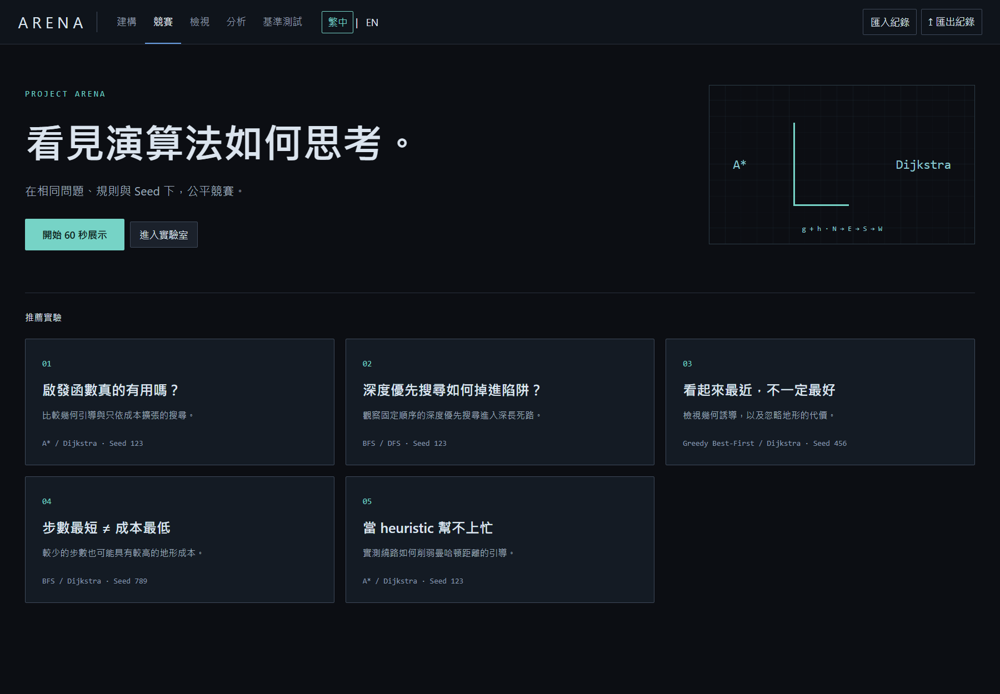

# ARENA — AI Algorithm Arena

### 可重現、可檢視、可比較的演算法實驗平台

**同一張地圖、同一組規則，為什麼不同演算法會做出不同決策？**

ARENA 將路徑搜尋轉化為可以操作、回溯與分析的實驗。使用者能建立地圖、比較演算法、逐步檢視節點，並保存完整執行紀錄；每一張視覺化畫面都來自 Rust 引擎的真實事件，而非預先編排的動畫。

**Rust · React · TypeScript · Canvas · Tauri 2** ｜ 繁體中文 / English ｜ Windows 桌面版 ｜ 目前版本 **0.1.2 · Phase 1.2**

[English](README.en.md) · [操作與開發指南](README.zh-TW.md) · [驗收報告](docs/phase12.md) · [GitHub Actions](https://github.com/oliverchenOVO/project-arena/actions)

閱讀路線：[實際操作](#操作流程與實際畫面) → [系統架構](#系統架構搜尋紀錄與呈現分離) → [技術亮點與程式入口](#技術亮點與程式入口) → [驗證證據](#工程驗證與可查核成果)。現場展示可參考 [三分鐘展示腳本](docs/portfolio.md#三分鐘展示腳本)。


同樣找到成本 62 的路徑，A* 展開 63 個節點，Dijkstra 展開 1,024 個節點。這是固定展示情境的實測結果，不代表 A* 在所有地圖上都較有效率。

> **一分鐘認識本作品**
>
> **問題：** 在相同輸入下，理解演算法的搜尋決策與成本差異。
>
> **方法：** Rust 真實執行 → 可驗證事件紀錄 → 重播、節點檢視與分析。
>
> **成果：** 5 種搜尋演算法、雙語 Windows 介面；Phase 1.2 完成 5,600 次 regression 執行，hash 與重播差異均為零。

## 專案動機：從「看動畫」到「理解決策」

演算法教學常以動畫呈現搜尋過程，但只看速度與顏色，很難回答「為什麼選這個節點」「這條路真的最便宜嗎」「改變啟發函數會怎樣」。ARENA 以可重現實驗為核心，把觀察畫面、節點狀態、執行數據與原始紀錄連接起來。

| 想理解的問題 | ARENA 提供的方法 |
| --- | --- |
| BFS 的最少步數是否等於最低成本？ | 在加權地形上與 Dijkstra 比較步數、成本與路徑 |
| A* 的啟發函數能減少多少搜尋？ | 同一地圖比較四種啟發函數，加入 Dijkstra 作為實測參考 |
| DFS、Greedy 在什麼情境容易繞路？ | 使用固定 Seed 的壓力地圖，重播其搜尋決策 |
| 畫面中的狀態能否被獨立驗證？ | 匯出事件紀錄，透過 Rust CLI 驗證 hash、路徑與重播結果 |

這個專案適合用於演算法教學、現場展示與實驗比較。它也呈現了從系統設計、資料契約、互動介面到自動化驗證的完整開發過程。

## 操作流程與實際畫面

以下介面截圖均取自實際封裝的 Windows 程式；數據來自執行紀錄。

### 1. 從展示情境開始，或自己建立問題

首頁提供五個固定 Seed 的展示：啟發函數、DFS 深度陷阱、Greedy 地形代價、BFS 加權成本，以及低資訊啟發情境。也可以進入實驗室，調整地圖、障礙比例、演算法與啟發函數，或直接繪製地形。



*導覽會在三個真實事件停點暫停，再帶入分析畫面；重新開始仍會得到相同的執行 hash。介面的「60 秒展示」是導覽形式，實際時間取決於播放速度與使用者停頓。*

### 2. 用並排與疊加畫面比較搜尋行為

競賽支援一對一、四方比較，以及四種啟發函數加 Dijkstra 參考。播放可以逐事件、逐節點展開或拖曳時間軸，並依事件數、展開數或進度百分比同步。疊加差異模式可觀察各演算法搜尋區域的重疊與差異。


*播放呈現已完成的搜尋紀錄，不會因動畫速度、暫停或時間軸拖曳而改變搜尋結果。*

### 3. 點選節點，追溯演算法的決策

檢視器顯示當前重播位置的節點狀態、距離 g、適用時的 h / f、父節點、展開次序與事件歷史。下圖是加權地形中的 BFS / Dijkstra 比較：BFS 找到較少步數的路徑，但該情境的成本為 191；Dijkstra 找到成本 33 的路徑。


*同一節點可能被 BFS 展開，卻未被 Dijkstra 造訪。檢視器保留這項差異，不以另一演算法的狀態補齊資料。*

### 4. 以數據解釋差異，而非只看播放速度

分析頁以四張獨立圖表比較已展開節點、邏輯操作數、峰值前沿大小與路徑成本，各自標示單位。詳細表格區分「實測數據」「推導指標」與「依規則解讀」，避免把推論當成量測事實。

<details>
<summary>展開完整分析畫面：四項指標、推導公式與解讀</summary>


</details>

本例中 A* 少展開約 93.8% 的節點，百分比由紀錄中的 63 / 1,024 計算。這描述的是搜尋工作量，不能直接解讀為程式執行時間快了 93.8%。

## 系統架構：搜尋、紀錄與呈現分離


| 層次 | 職責與設計重點 |
| --- | --- |
| **Rust 核心 `arena-core`** | 地圖生成、搜尋、事件、指標計數、匯入驗證與確定性分析；維持唯一搜尋實作 |
| **服務入口** | Tauri 桌面指令與開發 adapter 呼叫同一 Rust 服務；CLI 可無介面執行實驗 |
| **事件紀錄 RunLog** | 保存問題、版本、規則、事件與演算法指標，並建立 canonical SHA-256 |
| **重播與 React 介面** | 從事件恢復狀態，以 Canvas 顯示；前端不重新實作搜尋，也不以假資料補缺 |
| **驗證與 benchmark** | CLI 執行 correctness gates、hash 比對、重播與 seek 測試，輸出可保存的 JSON |
| **可選 AI 解讀介面** | 只接收分析資料，不能修改搜尋或紀錄；目前沒有設定 live LLM provider |

搜尋會先產生完整紀錄，再開始視覺播放。切換語言、調整速度或開啟簡報模式只影響呈現；不會更改地圖、Seed、hash 或實測指標。核心功能不需要 API key。

## 技術亮點與程式入口

作品的實作重點可從以下檔案直接查核。每項設計都對應一個問題、實作方式與驗證方法。

| 技術問題 | 實作與取捨 | 程式入口 | 如何驗證 |
| --- | --- | --- | --- |
| 相同輸入能否重現搜尋？ | 固定 RNG、鄰居與同分規則；版本化事件契約 | [Rust 搜尋核心](crates/arena-core/src/engine.rs)、[事件定義](crates/arena-core/src/event.rs) | 重複執行與歷史 hash 比對 |
| 前後拖曳時間軸，如何保持狀態正確？ | 事件 reducer 與檢查點恢復；以最多 33 個完整快照限制快照數量 | [前端重播](src/playback.ts)、[Rust 重播](crates/arena-core/src/replay.rs) | 將任意 seek 狀態與順序重播結果比較 |
| 匯入檔案可以直接信任嗎？ | 驗證 hash、版本、路徑、事件與計數，拒絕不合契約的紀錄 | [紀錄驗證](crates/arena-core/src/validation.rs) | [Rust correctness 測試](crates/arena-core/tests/phase1.rs) |
| 怎麼揭露演算法的弱點？ | 以固定 Seed 構造可調整壓力情境，再與參考演算法實測比較 | [壓力生成器](crates/arena-core/src/stress.rs)、[觀察規則](crates/arena-core/src/observation.rs) | [壓力測試](crates/arena-core/tests/phase11.rs) 與版本化門檻 |
| 切換語言會不會影響實驗？ | locale 與搜尋、RunLog、重播狀態分離；兩種語言共用鍵集合 | [i18n](src/i18n/index.tsx)、[雙語 E2E](tests/e2e/localization.spec.ts) | 保留 cursor、指標及逐位元組一致的匯出內容 |

檢查點設計限制的是**快照數量**，並非固定 RAM 上限；網格大小與事件紀錄仍影響記憶體。匯入驗證則針對目前的資料契約，不代表任意檔案都能相容。

## 關鍵設計：如何讓實驗可以重現？

1. **固定輸入與搜尋規則。** 使用 SplitMix64 v1 作為唯一種子亂數來源；鄰居固定為北 → 東 → 南 → 西，優先佇列以 priority、h 與插入次序決定同分順序。
2. **將結果保存為可驗證紀錄。** RunLog 保存網格、Seed、生成器、演算法、啟發函數、版本與事件；canonical hash 包含確定性資料，排除會隨主機負載改變的執行時間。
3. **重播不重新搜尋。** seek 從相近檢查點恢復狀態，再套用後續事件；匯入時由 Rust 驗證 hash、版本、路徑、事件順序與指標計數。
4. **將顯示狀態與執行資料分開。** 繁中 / English 的 374 個翻譯鍵只影響介面；測試確認即時切換後匯出 JSON 仍逐位元組一致。

詳見 [執行契約](docs/contracts.md) 與 [Phase 1.1 重播效能取捨](docs/phase11.md)。

## 支援演算法與實驗規則

| 演算法 | 核心策略 | 本專案中的保證 |
| --- | --- | --- |
| **BFS** — 廣度優先搜尋 | FIFO 佇列 | 最少步數；加權地形未必最低成本 |
| **DFS** — 深度優先搜尋 | LIFO 堆疊 | 可達性；不保證最短路徑 |
| **Dijkstra** — 最短路徑搜尋 | 依累積成本 g 排序 | 非負成本下的最優路徑成本 |
| **A\*** — A* 搜尋 | 依 g + h 排序 | 支援的可容許啟發函數下，最優路徑成本 |
| **Greedy Best-First** — 貪婪最佳優先搜尋 | 依 h 排序 | 可達性；不保證最低成本 |

地圖採四方向移動，目的地地形成本分別為一般 **1**、泥地 **3**、水域 **5**、高成本地形 **10**；障礙不可通行。起點成本為零，無法抵達的路徑成本與長度記為 `null`。

**指標的界線也屬於設計的一部分：**「邏輯操作數」計算展開、邊評估、入出佇列與鬆弛比較，不等於 CPU 指令；「狀態佔用代理值」計算狀態項目，不等於 RAM。計算時間包含搜尋與事件記錄，不包含視覺播放。

## 工程驗證與可查核成果

下列數字對應 **Phase 1.2 / 0.1.2** 的已保存驗收紀錄，並非持續更新的即時效能宣稱。

| 驗證項目 | 結果 | 證據 |
| --- | ---: | --- |
| Rust 測試 | **39 通過** | [驗收報告](docs/phase12.md) |
| 前端單元測試 | **48 通過** | [驗收報告](docs/phase12.md) |
| Playwright E2E | **33 通過，0 失敗 / flaky / skipped** | [驗收摘要](phase12-summary.json) |
| Phase 0 / 1 / 1.1 regression | **5,600 次執行、206,088 次 seek** | [驗收摘要](phase12-summary.json) |
| 重複執行 hash 檢查 | **2,800 次，0 mismatch** | [驗收摘要](phase12-summary.json) |
| 歷史 hash regression | **2,540 次比對，0 mismatch** | [驗收摘要](phase12-summary.json) |
| Replay divergence | **0** | [驗收摘要](phase12-summary.json) |
| Windows 實際封裝 smoke | **12 個雙語案例通過** | [桌面驗證](windows-phase12-verification.json) |
| 雙語字典 | **374 keys，0 缺漏** | [語言與資料一致性驗證](docs/phase12.md) |

Correctness gates 使用獨立的 O(V²) 最優路徑參考實作，分別檢查最少步數與最低成本。Benchmark 保存一般地圖 **360 筆**與壓力地圖 **180 筆**紀錄；本階段比對的歷史事件與演算法指標均一致。

執行時間受硬體、負載與地圖影響，不作為跨機器的絕對排名。大型紀錄的 seek 延遲與快照記憶體仍有取捨；曾實測更密集的檢查點，未採用該候選方案，保留比較證據而非宣稱沒有驗證過的效能提升。

## 適合延伸探討的問題

這是一個以系統實作與驗證為主的作品，以下是可沿用現有平台進一步研究的方向，並非已完成的研究結論：

- **啟發函數與地圖結構：** 比較走廊、死路、加權區域及啟發資訊量如何影響搜尋工作量。
- **重播系統的效能取捨：** 在事件紀錄大小、快照密度、記憶體與 seek 延遲之間建立可量測的比較。
- **演算法可解釋性：** 以節點歷史與明確區分的實測 / 推導 / 解讀資料，幫助使用者理解決策。

## 執行與開發

需要 **Node 24+、Rust stable**；Windows 桌面開發另需 **Visual Studio C++ Build Tools、WebView2 Runtime**。

```powershell
git clone https://github.com/oliverchenOVO/project-arena.git
cd project-arena
npm ci
cargo build --release -p arena-cli
npm run dev
```

開發介面位於 `http://127.0.0.1:1431/`，透過 adapter 呼叫 Rust CLI。`vite preview` 只提供靜態檔案；完整桌面與離線執行請使用 Tauri。

```powershell
# 桌面開發與封裝
npm run desktop:dev
npm run desktop:build
.\scripts\package-windows.ps1

# 核心與前端驗證
cargo test --workspace --release
npm test
npx playwright install chromium
npm run test:e2e

# 無介面執行、重播與基準測試
cargo run --release -p arena-cli -- run --seed 123 --algorithm astar --generator weighted --output example.arena.json
cargo run --release -p arena-cli -- replay --input example.arena.json --cursor 256
cargo run --release -p arena-cli -- benchmark --output benchmark.json
```

Windows 封裝產生 x64 執行檔、portable ZIP 與 NSIS 安裝程式，包含授權與依賴聲明。缺少 WebView2 時，安裝程式可下載 runtime；安裝 runtime 後核心可離線執行。完整檢查指令與 gate 用法見 [操作與開發指南](README.zh-TW.md)。目前 GitHub 尚未發布 Releases，請依上述步驟自行建置。

## 專案演進與範圍

| 階段 | 累積成果 |
| --- | --- |
| **Phase 0 / 1** | 確定性搜尋核心、事件契約、重播、編輯器、競賽、匯入匯出與 correctness gates |
| **Phase 1.1** | 壓力生成器、啟發函數比較、疊加差異、節點歷史、觀察規則與 benchmark |
| **Phase 1.2** | 完整雙語、展示首頁、首次導覽、簡報模式、分析圖表與 Windows 展示素材 |

此公開倉庫保留原始開發歷史與 Actions 紀錄，可透過 [commits](https://github.com/oliverchenOVO/project-arena/commits/main/) 查看系統如何逐步演進。

目前未設定 live AI 解讀服務；Windows 檔案未簽章，也未宣稱已通過乾淨機器安裝測試。Canvas 節點檢視仍以指標操作為主，並未宣稱完整螢幕閱讀器支援。3D、排序、帳號與多人功能不屬於目前已交付範圍。

## 更多資料與展示素材

- [推甄與個人網頁素材](docs/portfolio.md)：可引用的作品摘要、三分鐘展示腳本與附圖建議。
- [操作與開發指南](README.zh-TW.md)：雙語介面、執行方式與完整驗證指令。
- [Phase 1.2 驗收報告](docs/phase12.md)：雙語、四種尺寸、桌面與 regression 證據。
- [Phase 1.1 設計與實驗](docs/phase11.md)：壓力地圖、重播與效能取捨。
- [執行契約](docs/contracts.md)：事件、hash、計數與搜尋規則。
- [截圖目錄](docs/screenshots/) 與 [架構圖](docs/diagrams/arena-architecture.svg)：可用於本專案的個人網頁與推甄作品介紹；引用數據時請標示情境與版本。

程式碼採 [MIT 授權](LICENSE)；第三方依賴說明見 [THIRD_PARTY_NOTICES.md](THIRD_PARTY_NOTICES.md)。
