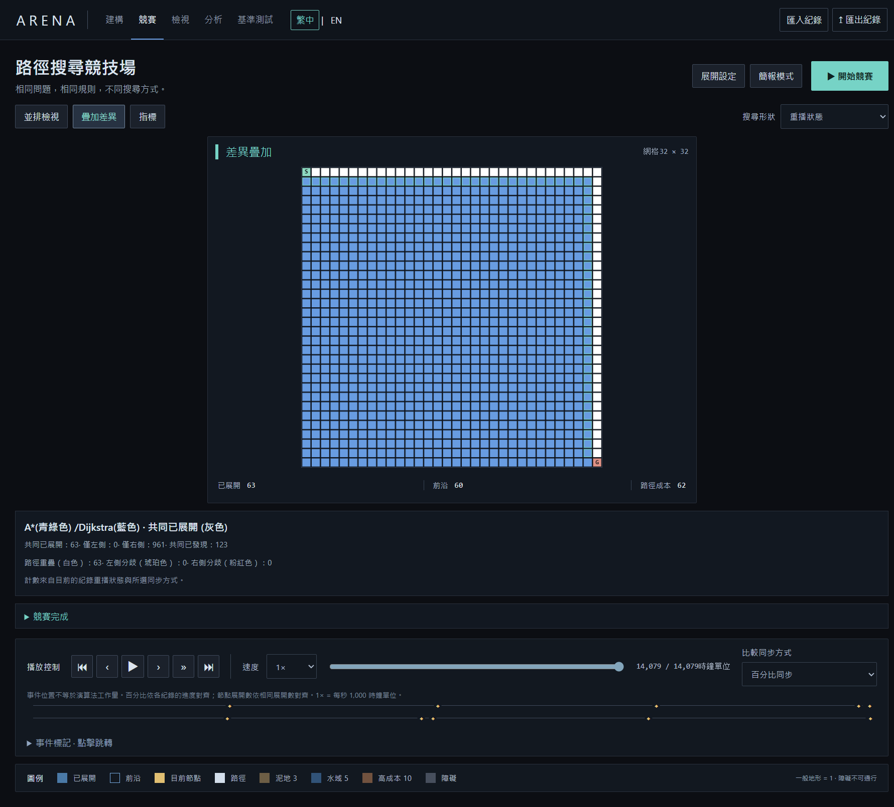
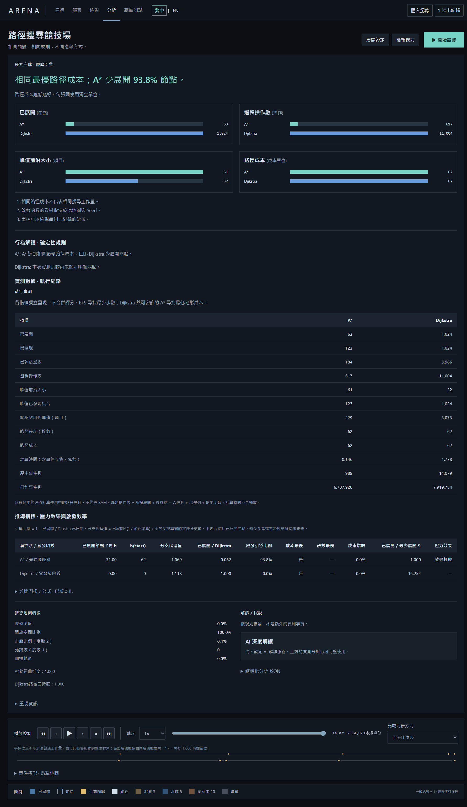

# ARENA — AI Algorithm Arena

[作品介紹](README.md) · [English](README.en.md) · 版本 **0.1.2**

在相同問題、規則與 Seed 下，讓演算法公平競賽。ARENA 使用 Rust 執行真實搜尋，保存可重現的事件紀錄，再以 React、TypeScript、Canvas 與 Tauri 2 呈現搜尋、重播與分析。


## 開始使用

首頁提供五個固定 Seed 的推薦展示：啟發函數是否有用、DFS 深度陷阱、Greedy 的地形代價、BFS 步數與成本的差異，以及低資訊啟發情境。「開始 60 秒展示」會真正執行 A* 與 Dijkstra，於三個真實事件里程碑暫停；按「繼續展示」觀察下一段，最後進入實測分析。時間隨播放速度與停頓而變，重新開始會得到相同 hash。

右上角可隨時切換 **繁中 / EN**。偏好依「已儲存語言 → 瀏覽器語言 → 繁中」決定。切換語言保留地圖、Seed、執行紀錄、重播位置、指標與匯出內容，不會再次執行演算法。

## 功能

- **建構**：種子生成地圖、尺寸與障礙比例、起終點、拖曳繪製加權地形、擦除與清除。編輯會清除前次執行。
- **競賽**：一對一、四方競賽，或四種啟發函數加 Dijkstra 實測參考；並排、疊加差異與搜尋形狀圖層。
- **檢視**：同一重播位置的節點狀態、g/h/f、父節點、展開時間、父節點變更與可跳轉的事件歷史。
- **分析**：實測數據、推導指標與行為解讀分開標示；已展開、邏輯操作數、峰值前沿大小與路徑成本使用獨立圖表與單位。
- **重播**：播放、暫停、前後事件、節點展開、任意 seek、事件 / 展開數 / 百分比同步與事件標記；匯入匯出 `.arena.json`。
- **壓力實驗**：四種可重現的 stress/1 地圖、參數調整與實測弱點門檻。
- **簡報模式**：收合設定、保留主要競賽與播放控制；按 Escape 或按鈕退出。
- **基準測試**：只讀取已儲存的 headless benchmark JSON，不執行搜尋。計算時間不包含播放。

不需要 API key。執行、重播與基準測試不呼叫 LLM；尚未設定 AI 深度解讀服務時，實測分析仍可完整使用。可選的解讀介面僅接收問題資訊、實測數據、推導指標與確定性解讀，不能修改執行結果。

## 演算法與規則

| 名稱 | 中文說明 | 保證 |
| --- | --- | --- |
| BFS | 廣度優先搜尋 | 最少步數；加權地形成本可能不是最低 |
| DFS | 深度優先搜尋 | 可達性；不保證最短路徑 |
| Dijkstra | 最短路徑搜尋 | 非負移動成本下的最優路徑成本 |
| A* | A* 搜尋 | 支援的可容許啟發函數下，最優路徑成本 |
| Greedy Best-First | 貪婪最佳優先搜尋 | 可達性；不保證最低成本 |

四方向鄰居固定為 **北 → 東 → 南 → 西**；優先佇列依 priority、h、插入次序處理相同優先序。DFS 依固定次序入堆疊，先探索最後符合條件的節點。曼哈頓距離、整數下取整的歐幾里得距離、切比雪夫距離與零啟發函數，在四方向、每次移動成本 ≥ 1 時皆可容許且一致。

一般地形成本 **1**、泥地 **3**、水域 **5**、高成本地形 **10**；障礙不可通行。移動採目的地成本，起點成本為零。無法抵達時，路徑成本與長度為 null，不以零代替。

前沿是等待展開的佇列項目，可能含惰性優先佇列的重複或過期項目。邏輯操作數 = 節點展開 + 邊評估 + 入佇列 + 出佇列 + 鬆弛比較。狀態佔用代理值計算狀態項目，不代表 RAM、位元組或 CPU 指令。

## 確定性架構

`arena-core` 負責生成、搜尋、事件、計數、驗證與觀察；`arena-cli` 提供無介面執行、gate 與 benchmark。Tauri 與 Vite 開發介面呼叫同一 Rust 服務。前端只消費事件紀錄，不含另一套搜尋演算法，也不使用假資料補缺。

搜尋先完整產生事件紀錄，再開始視覺播放。SplitMix64 v1 是唯一種子亂數來源。紀錄包含網格、Seed、生成器與版本、RNG、演算法與版本、啟發函數、鄰居與 tie-break 規則、地形成本、engine/schema 版本。編輯過的地圖以儲存網格為準。

canonical SHA-256 包含確定性輸入、事件與演算法指標；計算時間不納入 hash。語言只屬於呈現狀態，不寫入 canonical 紀錄。匯入會驗證版本、hash、路徑、事件順序與計數，重播直接讀取事件，不重新搜尋。完整快照最多 33 個，seek 從相近檢查點恢復並套用後續事件。見 [執行契約](docs/contracts.md)。

## 開發與驗證

需要 Node 24+、Rust stable；Windows 另需 Visual Studio C++ Build Tools 與 WebView2 Runtime。

```powershell
npm ci
cargo build --release -p arena-cli
npm run dev                  # http://127.0.0.1:1431
npm run desktop:dev
cargo fmt --all --check
cargo clippy --workspace --all-targets -- -D warnings
cargo test --workspace --release
npm run lint
npm run typecheck
npm test
npm run build
npx playwright install chromium
npm run test:e2e
```

若 Rust 不在 PATH，可加入 `$env:USERPROFILE\.cargo\bin`。瀏覽器開發模式需要 Rust CLI adapter；`vite preview` 只提供靜態檔案，完整離線執行請使用 Tauri 封裝。

本階段通過 **39 Rust 測試、48 前端單元測試、33 E2E**。原有 24 個 E2E 改以繁中執行，另增雙語核心流程、五個展示、四種尺寸、偏好保存、即時語言切換與導覽測試。Phase 0 / 1 / 1.1 共 **5,600 次執行、206,088 次 seek**，零 hash mismatch 與 replay divergence；歷史 benchmark 540 筆加上壓力紀錄 2,000 個 hash 完全一致。見 [Phase 1.2 證據](docs/phase12.md) 與 [機器可讀摘要](phase12-summary.json)。

## 無介面基準測試

```powershell
cargo run --release -p arena-cli -- gate --output phase0-gate.json
cargo run --release -p arena-cli -- gate-phase1 --output phase1-core-gate.json
cargo run --release -p arena-cli -- gate-phase11 --output phase11-stress-gate.json
cargo run --release -p arena-cli -- benchmark --output benchmark.json
cargo run --release -p arena-cli -- benchmark-stress --output stress-benchmark.json
```

一般 corpus 為 8 類地圖 × 3 個 Seed × 32/64/128 × 5 個演算法，共 360 筆；壓力 corpus 另有 180 筆。本機時間屬於特定主機、版本與負載的量測，不能作為跨機器絕對排名。新的實測紀錄保存在 `phase12-benchmark.json` 與 `phase12-stress-benchmark.json`；檢查點密度的先前取捨見 [Phase 1.1](docs/phase11.md)。

## Windows 封裝

```powershell
cargo fmt --manifest-path src-tauri/Cargo.toml --check
npm run desktop:build
.\scripts\package-windows.ps1
```

產生 x64 執行檔、portable ZIP 與 `Project ARENA_0.1.2_x64-setup.exe`，並包含授權與依賴聲明。安裝程式可在缺少 WebView2 時下載 runtime；安裝 runtime 後核心可離線使用。實際封裝程式的雙語執行、重播、檢視、分析、匯入與基準測試結果見 [Windows 驗證紀錄](windows-phase12-verification.json)。




## 限制

尚未設定可選 AI provider。Windows 二進位未簽章，也未宣稱通過乾淨機器的安裝測試。大型紀錄的重播記憶體與 seek 延遲仍有取捨。導覽時長隨使用者停頓與播放速度而變。排序、3D、帳號、多人與新增搜尋演算法不屬於本階段。

MIT 授權；詳見 `LICENSE`、`THIRD_PARTY_NOTICES.md` 及歷史 [驗收文件](docs/acceptance.md)。
