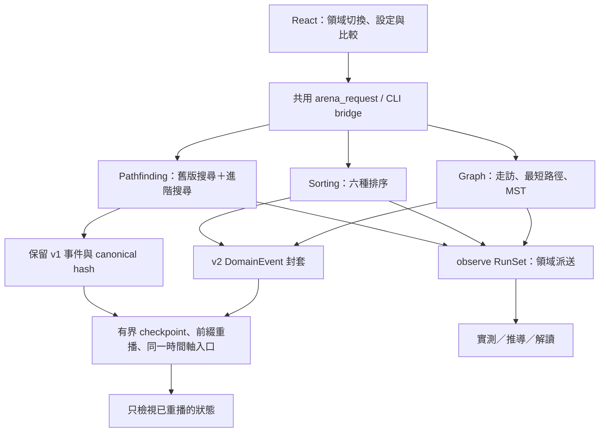

# Phase 2：多領域事件平台

本次擴充沿用 Phase 1.2 的 repository、Rust 核心、Tauri bridge、語言設定與時間軸入口。舊資料仍使用 `arena-engine/1` 的正規化序列，新增套件版本不代表改寫歷史執行版本。



## 不可變的相容性邊界

- v1 `.arena.json` 可匯入；pathfinding v2 外層封裝內保留原始 log。
- v2 外層為 `format / version / domain / problem / algorithms / logs`。排序與圖論事件共用 `schemaVersion / domain / runId / algorithmId / tick / sequence / eventType / payload`。
- 匯入先檢查版本、雜湊與相同問題，再由 Rust 驗證預期事件，避免把偽造狀態交給前端 reducer。
- 計算時間不進入 canonical hash。坐標、輸入、策略、事件、演算法指標進入雜湊。
- SplitMix64 與舊四鄰接順序不變。Graph 使用整數格點與 seeded jitter，沒有每次重播重新計算的 force layout。

## 計量定義

Sorting 的讀取涵蓋主陣列與 Merge 輔助緩衝區；交換包含兩次讀取與兩次寫入。比較計數只對 `Compare` 計數。邏輯操作為 `reads + writes + comparisons`，交換不再重複加權。穩定排序使用元素原始 identity 驗證相等值順序。輔助記憶體代理量是同時存活的輔助陣列元素數，遞迴深度另外呈現，不宣稱實際 RAM。

Quick 使用固定末元素 Lomuto pivot；嚴格單調與全相等輸入會退化至平方級比較次數。一般反向資料可能含重複值，仍應以本次量測判斷。Insertion、Bubble、Merge 的展示分別用幾乎排序、反向輸入及輔助記憶體取捨。

Graph 的 DSU 代理量計算 find 的根檢查及壓縮步數，優先佇列計算 push/pop。BFS/DFS 走訪全圖所有連通分量，最短路徑搜尋在目標處停止。MST 限定連通、無向、加權圖，Prim/Kruskal 的等權邊排序規則固定；同權重 MST 的邊集合不必相同。

Graph A* 的整數 L1 幾何下界以最小邊權／邊幾何跨度縮放；每條邊的估計不超過真實成本。坐標只是問題的一部分，不假設原始權重等於幾何距離。

Weighted A* 使用固定百分比 `100*g + weight_percent*h` 排序，`w ∈ {1, 1.25, 1.5, 2, 3}`。事件另外記錄精確 scaled priority，界面顯示 `g+w*h`；`w>1` 不保證最優。Bidirectional BFS 每次完整展開一層、選擇該層最短會合候選，只允許對稱單位成本地形。

## 重播與展示

三個領域的重播都只套用事件；演算法只在 Rust 執行。每份 log 最多 33 個 checkpoint；邊狀態以不可變紀錄共享，修改時複製該紀錄，避免每個快照深複製數萬條邊。播放以 animation frame 批次套用事件，再繪製 Canvas，沒有逐事件建立 React DOM 節點。圖論 Canvas 快取靜態底圖，依狀態分組批次畫邊，ResizeObserver 不隨每次重播重建。

排序提供事件／比較次數／百分比同步；語意步進停在比較或交換。圖論語意步進停在節點訪問或邊評估。不同演算法的事件數不能當成同等工作量。

首頁預覽來自 `src/fixtures/domain-showcase.json`，可用 `node scripts/phase2-fixtures.mjs` 重新產生。固定資料可以核對 hash，不包含假的動畫。

## 重現命令

```powershell
cargo test --workspace --release
cargo clippy --workspace --all-targets -- -D warnings
cargo run --release -p arena-cli -- benchmark --domain sorting --output phase2-sorting-benchmark.json
cargo run --release -p arena-cli -- benchmark --domain graph --output phase2-graph-benchmark.json
cargo run --release -p arena-cli -- benchmark --domain all --output all-domains.json
node scripts/phase2-regression.mjs
npm run test
npm run test:e2e
npm run desktop:build
```

900 筆排序 corpus：6 演算法 × 6 資料家族 × 5 大小 × 5 seeds。圖論 corpus：6 家族 × 4 大小 × 5 seeds，連通家族測六演算法，不連通家族跳過兩種 MST，共 680 筆。七種排序分布與八種圖論生成器全部可在互動界面使用。
