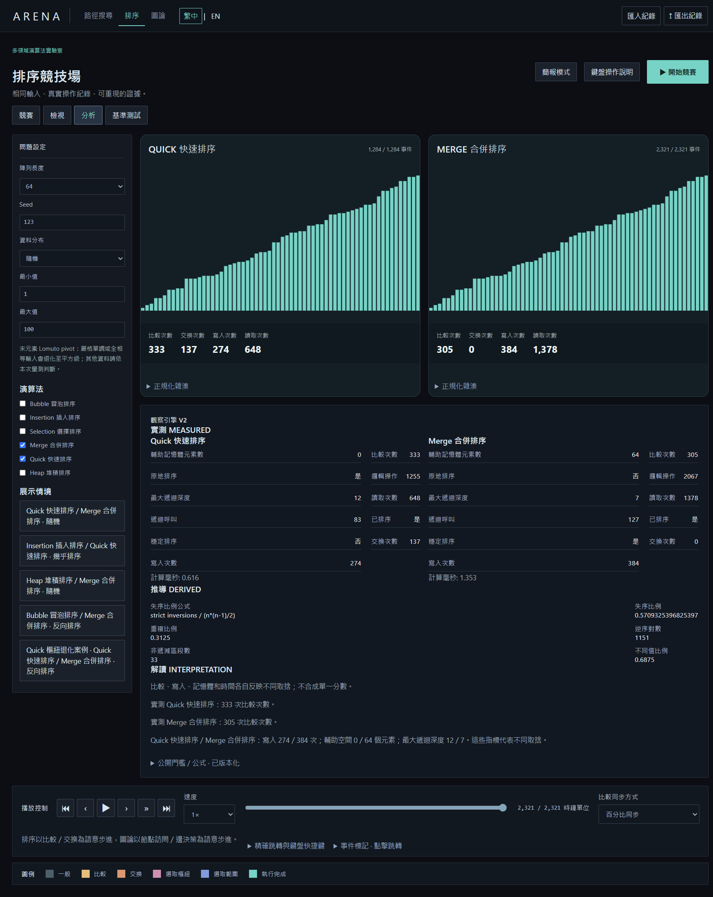
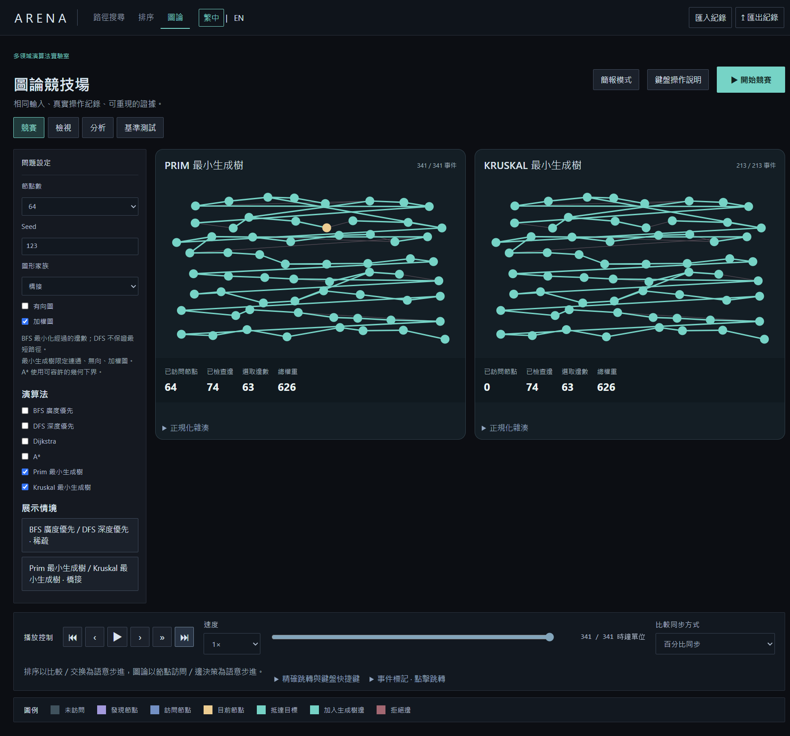

# Phase 2 — Multi-Domain Algorithm Arena 驗收

[中文作品介紹](../README.md) · [架構與契約](phase2-design.md) · [機器可讀摘要](../phase2-summary.json)

## STATUS

**0.2.0 本機驗收 PASS。** 沿用既有 repository 與 Rust deterministic core，完成路徑搜尋、排序、圖論的執行、重播、檢視、分析與雙語界面。本頁列出保存的驗證結果，GitHub CI 另外對推送的 commit 執行，不能用本機結果代替。

## DOMAINS

三領域共享 bridge、事件版本邊界、時間軸入口、語言設定及觀察入口；各自保留問題與播放位置。排序與圖論採通用 DomainPlayback，舊 pathfinding reducer 保留，透過 adapter 兼容 v2，沒有重寫舊紀錄。

## ALGORITHMS

| 領域 | 實作 |
| --- | --- |
| Pathfinding（7） | BFS、DFS、Dijkstra、A*、Greedy、Bidirectional BFS、Weighted A* |
| Sorting（6） | Bubble、Insertion、Selection、Merge、Quick、Heap |
| Graph（6） | BFS、DFS、Dijkstra、A*、Prim、Kruskal |

共 19 個領域內實作；BFS 等名稱跨領域重複，不代表 19 種不同的演算法理論。

## DETERMINISM

舊 gates 重新完成 **5,600 次執行、2,800 次重複 hash 比對、206,088 次 seek**。新領域 corpus 完成 **3,160 次執行、1,580 次重複 hash 比對、6,320 次 checkpoint 前綴驗證**。這些範圍內 hash mismatch、replay divergence 均為 **0**；單元／E2E／桌面操作的額外執行不併入這個 corpus 總數。

時間不進入 canonical hash；Graph 的 seeded 整數坐標進入問題內容。所有優先順序、鄰接排序與 Quick pivot 策略固定。

## LEGACY COMPATIBILITY

v1 pathfinding 匯入仍可使用，v2 的外層保留原始 v1 log。360 筆一般 benchmark、180 筆壓力 benchmark 與 2,000 份歷史 stress hash，共 **2,540 次比對全部一致**；演算法指標差異為 **0**。證據：[歷史相容](../phase2-legacy-compatibility.json)、[Phase 0](../phase2-phase0-gate.json)、[Phase 1](../phase2-phase1-gate.json)、[stress gate](../phase2-stress-gate.json)。

## SORTING BENCHMARK

**900 筆**：6 演算法 × 6 資料家族 × 5 尺寸 × 5 seeds。每筆以 Rust 標準排序核對結果，再重複執行與檢查四個重播位置。hash mismatch **0**，3,600 次 replay checks 的 divergence **0**。[原始紀錄](../phase2-sorting-benchmark.json)。

界面另支援第七種分布 shuffled blocks。讀取包含 Merge 緩衝區，swap 計兩次讀取與兩次寫入；logical operations 為 reads + writes + comparisons。穩定性以原始元素 identity 驗證，輔助空間計元素數，遞迴深度另外呈現。

此固定 Seed、64 元素案例中 Quick／Merge 的比較為 333／305 次，寫入為 274／384 次，輔助空間為 0／64 個元素，最大深度為 12／7。這是特定輸入的實測，沒有宣稱某算法在所有輸入上更好。

## GRAPH BENCHMARK

**680 筆**：6 家族 × 4 尺寸 × 5 seeds，連通家族測六演算法，不連通家族跳過兩個 MST。hash mismatch **0**，2,720 次 replay checks 的 divergence **0**。[原始紀錄](../phase2-graph-benchmark.json)。

互動界面提供全部 8 種生成器。BFS／DFS 走訪全圖所有連通分量；BFS 的最短性指經過的邊數，不能當成加權最短成本。Dijkstra／A* 與 Prim／Kruskal 分別核對成本／生成樹權重；測試另以獨立 Bellman–Ford 驗證最短路徑。

此 bridge 圖有 64 節點，兩者都選 63 條邊、總權重 626；Kruskal 的 node visited 為 0，因為它執行的是邊排序與 DSU，而不是節點走訪。畫面不捏造 visited 次數來讓不同算法看起來相同。

## PATHFINDING ADVANCED

Bidirectional BFS 真正交替展開完整前後層，記錄雙前緣、展開數與 meeting event，限對稱單位成本移動。50 個 seeds 與 BFS 核對路徑成本及重播狀態。

Weighted A* 用整數比例精確比較 `100*g + weight_percent*h`，事件另記 scaled priority；w=1／1.25／1.5／2／3 全部測試。w=1 與 Dijkstra 成本一致；w>1 不宣稱最優，分析同時顯示實際展開減少和成本增加。缺少 Dijkstra 參考時比例保留未定義。[實際 Windows 操作](../windows-phase2-verification.json) 包含兩種進階搜尋的雙語案例。

## REPLAY

只套用事件、不在前端再次執行演算法。最多 33 個 checkpoint，圖論邊狀態採不可變共享與修改時複製。支持事件／比較或展開／百分比同步、語意步進、起終點與事件跳轉、鍵盤說明。Inspector 只讀已播放前綴，不含未來事件。

20 項 v2 匯入驗證通過，包含有效紀錄、時間排除、錯誤 hash，以及重新 seal 後的偽造指標／runId；後兩者仍由 Rust 重執行驗證拒絕。[匯入證據](../phase2-import-verification.json)。

256 元素排序、256 節點 dense 圖、128×128 路徑搜尋已實測。[新領域 profile](../phase2-profile.json)、[路徑搜尋 profile](../phase2-pathfinding-profile.json)。排序 RAF p95 約 16.7 ms、密集圖約 33.4 ms；128×128 雙搜尋約 50 ms。checkpoint／seek 另列 reducer 量測；時間受同一開發機的負載影響，不能推出跨硬體排名或保證所有尺寸 60 FPS。

## TESTS

| 驗證 | 結果 |
| --- | ---: |
| Rust workspace tests | 46 PASS |
| 前端單元 | 61 PASS |
| Playwright E2E | 43 PASS，0 failure／flaky／skipped |
| Rust fmt／clippy（warnings denied） | PASS |
| TypeScript／ESLint／production build | PASS |
| Tauri fmt／Windows NSIS build | PASS |
| 繁中／英文字典 | 574 keys，0 缺漏 |

本環境沒有 Browser plugin，依 frontend-testing-debugging skill 使用一般 Playwright。真實 Windows WebView2 另透過 CDP 操作，確認 Tauri bridge 而非 dev HTTP adapter。

## WINDOWS

v0.2.0 x64 portable EXE、ZIP、NSIS 均成功產生。真實封裝程式在繁中／英文共 **14 案例通過**，含三領域 run、replay、inspect、analyze、export/import、benchmark、Insertion／Quick、Prim／Kruskal 與進階搜尋。console errors **0**、外部請求 **0**。[驗證與 SHA-256 manifest](../windows-phase2-verification.json)。

桌面匯出檢查實際 UI 產生的 JSON Blob，再以檔案匯入；沒有自動操作作業系統另存對話框。瀏覽器 E2E 另外驗證真實下載與匯入。

## GITHUB

沿用 [oliverchenOVO/project-arena](https://github.com/oliverchenOVO/project-arena) 的 public `main`，保留原始 commit history 與 Actions。既有 [verification workflow](https://github.com/oliverchenOVO/project-arena/actions/workflows/ci.yml) 檢查 Rust、前端／E2E 與 Windows 打包，既有 stress workflow 檢查歷史 gates。各結果須對照推送 commit；unsigned Windows 建置檔由 Actions artifact 提供，尚未另外建立 GitHub Release。

## KNOWN ISSUES

- Windows 產物未簽章；沒有宣稱乾淨機器安裝測試通過。
- 原生匯出測試未自動操作 OS 另存對話框。
- AI Reflection provider 尚未設定；規則觀察與數值分析可離線使用。
- 真實展示 log 讓前端主 chunk 約 1.25 MB、gzip 約 170 KB，Vite 會提示大小警告。尚未把展示紀錄拆成延後載入資源。
- 大圖畫面與 Canvas 指標檢視仍有可讀性／無障礙限制；不宣稱完整螢幕閱讀器支援。
- 3D、帳號、雲端同步與多人功能不在此次範圍。

重現命令與架構見 [設計](phase2-design.md)，Windows 操作腳本見 [phase2-visual-smoke](../scripts/phase2-visual-smoke.mjs)。
