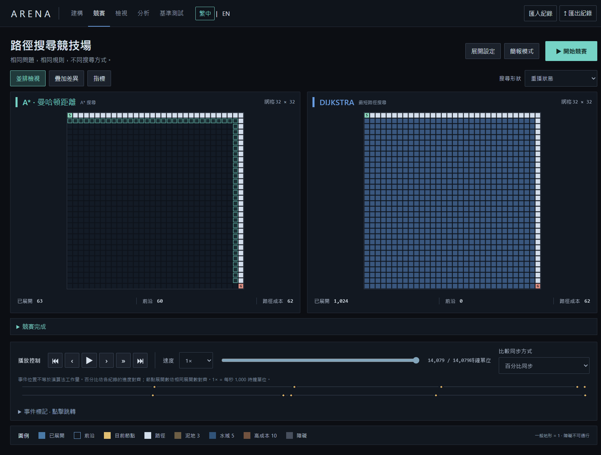
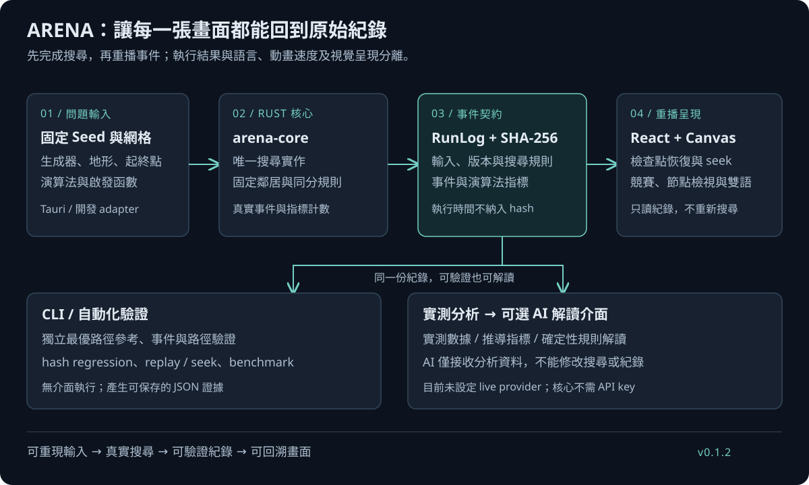
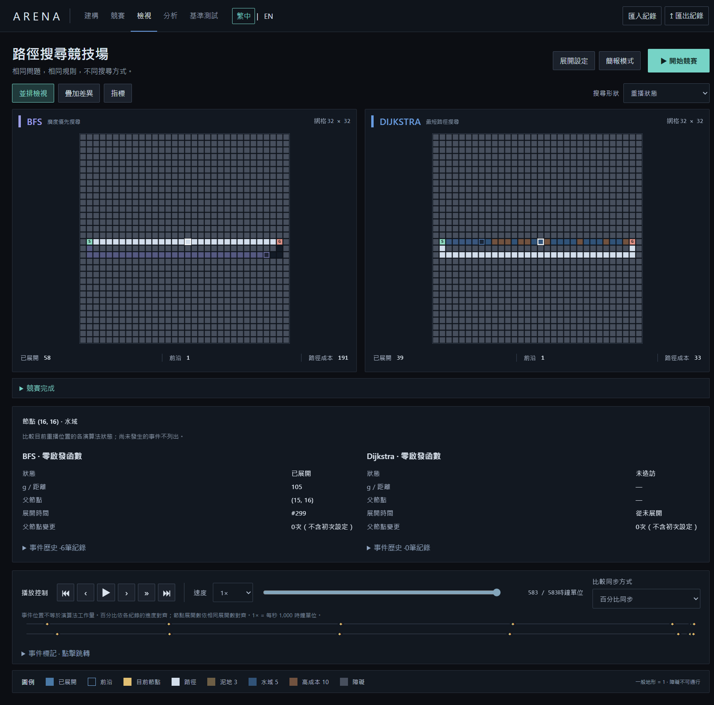

# ARENA：推甄與個人網頁展示素材

[返回作品介紹](../README.md) · [實際驗收證據](phase12.md)

本頁依已完成的 **Phase 1.2 / 0.1.2** 整理，可用於個人網頁、備審作品說明與口頭展示。摘要描述專案成果；作者角色、實作分工與 AI 工具使用情況，請依實際經歷另行補充。

## 個人網頁短版摘要

**ARENA — 可重現的演算法實驗平台**

以 Rust 執行真實路徑搜尋，React 與 Canvas 呈現競賽、事件重播與節點檢視，並以 Tauri 提供雙語 Windows 桌面介面。支援 BFS、DFS、Dijkstra、A* 與 Greedy Best-First；使用者可在相同地圖與規則下比較搜尋工作量與路徑成本，保存紀錄並驗證結果。

**技術：** Rust / React / TypeScript / Canvas / Tauri 2 
**亮點：** 確定性事件契約、可回溯的搜尋決策、headless regression gates 
**作品連結：** [公開 repository](https://github.com/oliverchenOVO/project-arena)

## 備審作品說明

ARENA 探討如何把演算法視覺化轉化為可重現、可檢查的實驗。平台在相同地圖、Seed 與移動規則下執行多種路徑搜尋，記錄節點、成本與父節點變更，再以事件重播與檢視器呈現決策過程。實測數據、推導指標與規則解讀分開標示，使比較具有明確依據。

系統以 Rust 作為唯一搜尋實作，前端只消費 RunLog。canonical SHA-256 排除執行時間；語言切換、播放速度與 seek 不改變搜尋結果。CLI 提供獨立 correctness gates、benchmark 與紀錄驗證，Tauri 將相同核心封裝為雙語桌面應用。

Phase 1.2 的證據包含 39 個 Rust 測試、48 個前端測試、33 個 E2E，以及 5,600 次 regression 執行與 206,088 次 seek，未出現 hash mismatch 或 replay divergence。後續可利用平台研究啟發資訊量與地圖結構的關係，以及事件重播的記憶體／延遲取捨。

以上數據對應既有驗收版本，不能取代後續版本的重新驗證；它是系統作品的工程證據，並非論文發表或新演算法的宣稱。

## 三分鐘展示腳本

展示前先啟動程式，選擇繁中，確認窗口能顯示主要競賽與播放控制。以下時間是口頭展示安排，操作與停頓可依現場調整。

| 時間 | 操作 | 說明重點 |
| --- | --- | --- |
| 0:00–0:30 | 首頁選擇「啟發函數真的有用嗎？」並執行 | 「同一問題與規則，比較不同搜尋決策。」 |
| 0:30–1:00 | 暫停，逐節點展開或拖曳時間軸 | 「畫面來自真實紀錄；往回看也不需要重新搜尋。」 |
| 1:00–1:30 | 跳到結尾，開啟分析 | 「本情境成本同為 62；A* 展開 63，Dijkstra 展開 1,024，差異是搜尋工作量。」 |
| 1:30–2:00 | 回首頁，執行 BFS 加權成本情境 | 「最少步數與最低成本是不同目標；BFS 與 Dijkstra 的差異有其理由。」 |
| 2:00–2:30 | 選擇檢視並點選路徑上的節點 | 「可以看到節點成本、父節點和實際發生的歷史事件。」 |
| 2:30–3:00 | 切換 English，展示匯出入口，再說明架構 | 「語言與播放只屬於呈現；Rust 核心、RunLog 與 CLI 驗證分離。」 |

若節點沒有 h / f 或未被造訪，保留「不適用／未造訪」的狀態即可。每種演算法的狀態不同，不需要挑選看起來所有欄位都有值的節點。

## 推薦附圖與圖說

### 主畫面：讓審閱者先理解產品

**可引用圖說：** 固定展示情境下，A* 與 Dijkstra 找到相同成本的路徑，但展開節點數不同。平台以相同問題與規則比較搜尋行為，並支援事件重播與結果保存。

### 架構圖：說明設計能力

**可引用圖說：** Rust 核心產生真實搜尋事件與指標，RunLog 保存可驗證結果；前端依事件重播，CLI 提供 correctness 與 hash regression 驗證。

### 節點檢視：說明可解釋性

**可引用圖說：** 加權地形情境中，BFS 與 Dijkstra 分別追求最少步數與最低成本。檢視器呈現同一節點在不同演算法中的實際紀錄，不將未發生的事件補成觀測值。

個人網頁可將主畫面設為專案卡片圖片，架構圖放於詳細介紹；備審版建議以「主畫面＋架構圖」為核心，保留圖片比例與可讀性，詳細分析改用連結補充。

## 口試可準備的技術問題

| 問題 | 回答方向與證據 |
| --- | --- |
| 為什麼不在前端再寫一次搜尋？ | 維持單一搜尋實作，讓 CLI、桌面與開發介面共享規則；見 [服務入口](../crates/arena-core/src/bridge.rs) |
| 相同 Seed 是否足夠保證重現？ | 仍需固定網格、演算法、版本、鄰居與同分規則；見 [執行契約](contracts.md) |
| 快照越多是不是越好？ | 需一起比較快照建立時間、記憶體與 seek 延遲；見 [Phase 1.1 實測取捨](phase11.md) |
| 少展開節點是否就代表更快？ | 展開數是工作量指標；實際耗時還受優先佇列、事件記錄與主機影響 |
| 專案名稱有 AI，是否使用 LLM 搜尋？ | 核心搜尋不呼叫 LLM；目前只有可選解讀介面，未設定 live provider；見 [解讀介面](../src/explanation.ts) |

## 引用範圍

目前沒有已發布的 GitHub Releases、已完成的 3D 功能或 live AI provider。Windows 簽章與乾淨機器安裝測試未宣稱完成。測試數字請標示 **Phase 1.2 / 0.1.2**；若提出未來研究方向，應與已完成成果分開。
